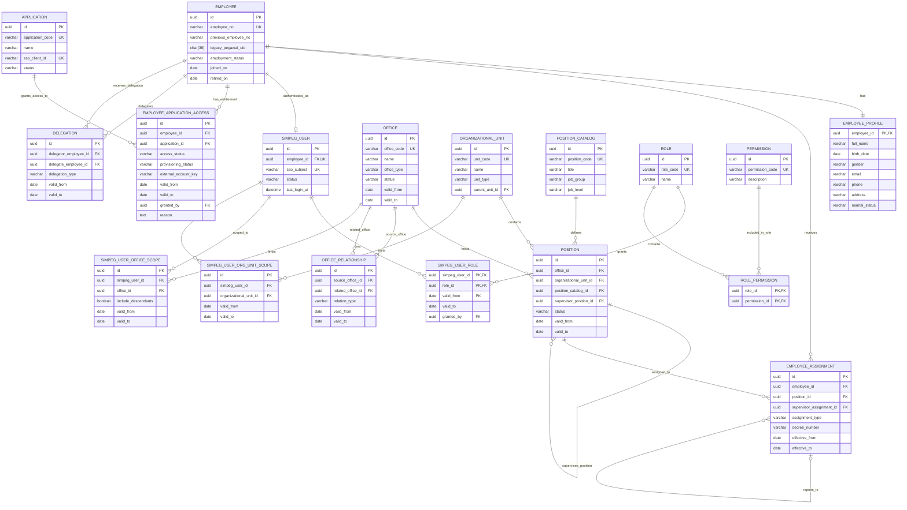
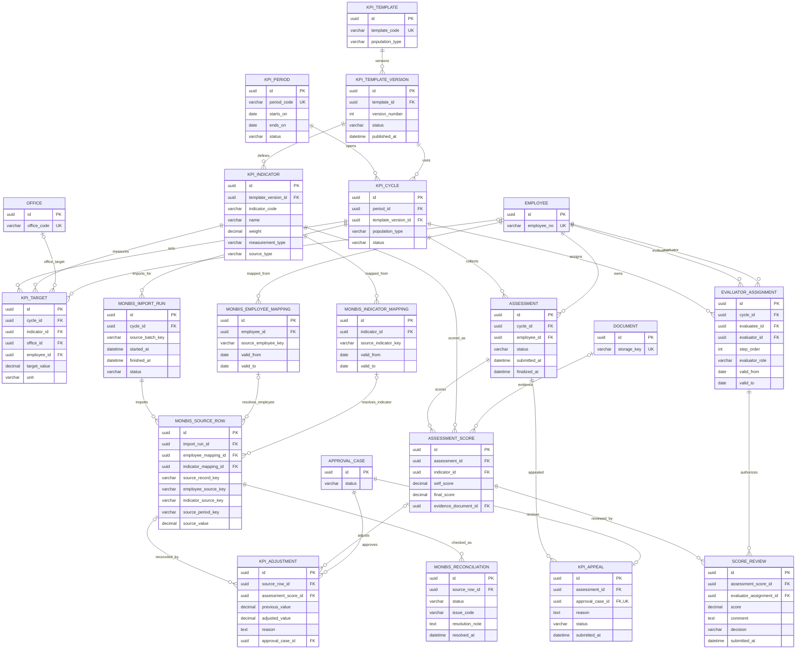
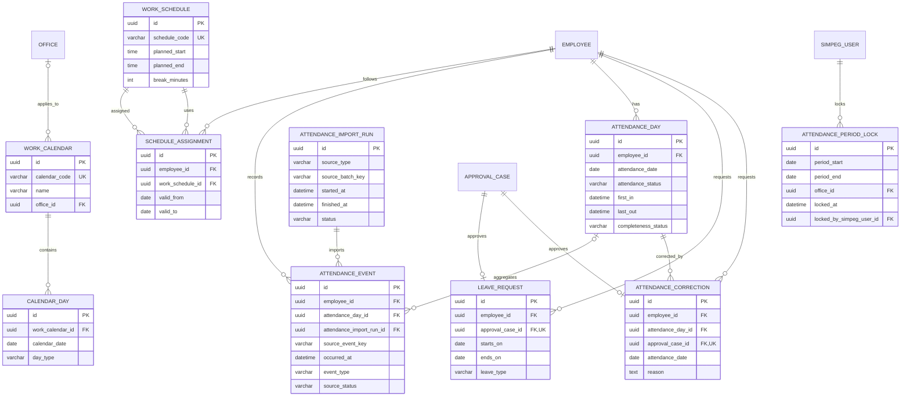

# ERD Konseptual SIMPEG v2

Versi: 0.2, 15 Oktober 2026. Status: draft untuk review HR, pemilik aplikasi, SSO, dan DBA.

PRD utama: [PRD SIMPEG Perbankan](PRD-SIMPEG-PERBANKAN.md). Sumber legacy: `db/masq2971_simpeg_dummy.sql`.

## Batas dokumen

Dokumen ini mengusulkan model target. Ini bukan hasil reverse-engineering lengkap dari aplikasi lama dan belum menjadi migration/schema SQL. Pemeriksaan dump hanya membaca DDL, bukan isi `INSERT`. Saya menemukan 44 definisi tabel. Saya belum menguji data, query aplikasi lama, foto/dokumen, atau kelengkapan relasi.

Nama produk yang diminta adalah `simpeg-v2`. Pengguna menyetujui nama schema MySQL `simpeg_v2` pada 15 Oktober 2026. Database lama tetap ada sebagai sumber baca/rollback sampai pemilik data menyetujui cutover dan retensinya. Tidak ada database yang dibuat, di-rename, atau diubah dalam tahap PRD ini.

Label dalam dokumen:

- **Legacy teramati**: nama/kolom/constraint ditemukan di DDL sumber.
- **Target usulan**: entitas atau hubungan konseptual yang perlu divalidasi.
- **Terbuka**: memerlukan keputusan pemilik proses atau pengecekan pemakaian.

## 1. ERD pegawai, organisasi, dan akses

Aturan rancangan:

- `employee_no` memetakan `tb_pegawai.id_peg`, yang menjadi primary key legacy dan dipakai pada request login SSO. Validasi bahwa SSO `employee_id` selalu sama sebelum migrasi. `pegawai_uid` ada di DDL tetapi bukan primary key; pertahankan sebagai identifier sumber hanya jika data dan pemakaiannya tervalidasi. `id_peg_old` menjadi identifier lama, bukan kunci relasi utama.
- `EMPLOYEE_PROFILE` berisi PII. Hak baca dan perubahan perlu lebih ketat daripada data penempatan. Field final mengikuti kamus data HR.
- `OFFICE_RELATIONSHIP` menyimpan relasi bertanggal, termasuk parent administratif dan koordinasi wilayah jika memang berbeda. Validasi mencegah siklus parent dan periode tumpang tindih yang tidak diizinkan.
- `POSITION_CATALOG` menyimpan jenis jabatan. `POSITION` adalah slot/posisi pada kantor dan unit tertentu. `EMPLOYEE_ASSIGNMENT` mencatat siapa menempati posisi dan kapan.
- Penilai KPI memakai assignment efektif pada periode, atau delegation yang disetujui. Role seperti Kabid/Kadiv saja tidak cukup untuk menentukan akses.
- `SIMPEG_USER` pada ERD ini adalah pemetaan identitas untuk login ke SIMPEG saja. Ia tidak menyimpan password SSO dan tidak berarti pegawai otomatis berhak masuk semua aplikasi.
- `EMPLOYEE_APPLICATION_ACCESS` memisahkan entitlement aplikasi dari provisioning akun. `provisioning_status` dan `external_account_key` mencatat hasil pembuatan akun tanpa menyimpan password/OTP. Jika SSO menjadi pemilik entitlement, data ini disimpan atau dikelola melalui layanan SSO, bukan diduplikasi sebagai sumber kedua di SIMPEG.
- Role dan permission pada diagram ini adalah hak di dalam SIMPEG. Aplikasi lain menetapkan menu/endpoint menurut role mereka. Saat entitlement aplikasi `off`, seluruh API pada aplikasi itu ditolak dan UI boleh menampilkan tanpa menu yang bisa dipakai; sistem tidak perlu menyetel flag 0 satu per satu pada setiap menu.
- Role dapat berubah menurut tanggal. Scope kantor harus dicek backend untuk daftar, detail, pencarian, export, dan job.
- Role mengelompokkan permission, sedangkan assignment scope membatasi data ke kantor atau unit kerja. Perubahan role/scope memiliki masa berlaku dan aktor pemberi.

## 2. ERD riwayat, pengembangan, dokumen, dan approval

```mermaid
erDiagram
    EMPLOYEE ||--o{ FAMILY_MEMBER : has
    EMPLOYEE ||--o{ EDUCATION_RECORD : studied
    EMPLOYEE ||--o{ EMPLOYEE_TRAINING : attends
    TRAINING_COURSE ||--o{ EMPLOYEE_TRAINING : records
    EMPLOYEE ||--o{ EMPLOYEE_CERTIFICATION : holds
    CERTIFICATION_CATALOG ||--o{ EMPLOYEE_CERTIFICATION : classifies
    EMPLOYEE ||--o{ LANGUAGE_SKILL : reports
    EMPLOYEE ||--o{ CAREER_EVENT : records
    EMPLOYEE ||--o{ EMPLOYEE_AWARD : receives
    EMPLOYEE ||--o{ EMPLOYEE_DISCIPLINARY_RECORD : has_restricted_record
    EMPLOYEE ||--o{ NOTIFICATION : receives
    EMPLOYEE ||--o{ EMPLOYEE_DOCUMENT : owns
    DOCUMENT ||--o{ EMPLOYEE_DOCUMENT : stored_as
    DOCUMENT ||--o{ EMPLOYEE_TRAINING : supports
    DOCUMENT ||--o{ EMPLOYEE_CERTIFICATION : supports
    DOCUMENT ||--o{ CAREER_EVENT : supports
    DOCUMENT ||--o{ EMPLOYEE_AWARD : supports
    DOCUMENT ||--o{ EMPLOYEE_DISCIPLINARY_RECORD : supports
    EMPLOYEE ||--o{ PROFILE_CHANGE_REQUEST : requests
    APPROVAL_CASE ||--o{ APPROVAL_STEP : contains
    APPROVAL_CASE ||--o| PROFILE_CHANGE_REQUEST : reviews
    APPROVAL_CASE ||--o| LEAVE_REQUEST : reviews
    APPROVAL_CASE ||--o| ATTENDANCE_CORRECTION : reviews
    SIMPEG_USER ||--o{ APPROVAL_STEP : acts
    SIMPEG_USER ||--o{ AUDIT_EVENT : performs

    FAMILY_MEMBER {
        uuid id PK
        uuid employee_id FK
        varchar relationship_type
        varchar full_name
        date birth_date
        varchar education_level
        varchar occupation
        varchar verification_status
    }
    EDUCATION_RECORD {
        uuid id PK
        uuid employee_id FK
        varchar level
        varchar institution
        varchar major
        date graduated_on
        varchar verification_status
    }
    TRAINING_COURSE {
        uuid id PK
        varchar title
        varchar provider
        varchar category
        date starts_on
        date ends_on
    }
    EMPLOYEE_TRAINING {
        uuid id PK
        uuid employee_id FK
        uuid training_course_id FK
        varchar completion_status
        varchar result
        uuid document_id FK
    }
    CERTIFICATION_CATALOG {
        uuid id PK
        varchar certification_code UK
        varchar name
        varchar issuer
    }
    EMPLOYEE_CERTIFICATION {
        uuid id PK
        uuid employee_id FK
        uuid certification_catalog_id FK
        date issued_on
        date expires_on
        varchar verification_status
        uuid document_id FK
    }
    LANGUAGE_SKILL {
        uuid id PK
        uuid employee_id FK
        varchar language
        varchar skill_level
        varchar verification_status
    }
    DOCUMENT {
        uuid id PK
        varchar storage_key UK
        varchar media_type
        bigint file_size
        varchar checksum
        datetime uploaded_at
    }
    EMPLOYEE_DOCUMENT {
        uuid employee_id PK,FK
        uuid document_id PK,FK
        varchar document_type
        varchar visibility
    }
    CAREER_EVENT {
        uuid id PK
        uuid employee_id FK
        varchar event_type
        date effective_on
        varchar decree_number
        uuid document_id FK
    }
    EMPLOYEE_AWARD {
        uuid id PK
        uuid employee_id FK
        varchar award_name
        date awarded_on
        varchar issuer
        uuid document_id FK
    }
    EMPLOYEE_DISCIPLINARY_RECORD {
        uuid id PK
        uuid employee_id FK
        varchar record_type
        date effective_on
        varchar status
        uuid document_id FK
    }
    NOTIFICATION {
        uuid id PK
        uuid employee_id FK
        varchar notification_type
        varchar status
        datetime created_at
        datetime read_at
    }
    APPROVAL_CASE {
        uuid id PK
        varchar status
        datetime submitted_at
        datetime closed_at
    }
    APPROVAL_STEP {
        uuid id PK
        uuid approval_case_id FK
        uuid approver_simpeg_user_id FK
        int step_order
        varchar decision
        text reason
        datetime decided_at
    }
    PROFILE_CHANGE_REQUEST {
        uuid id PK
        uuid employee_id FK
        uuid approval_case_id FK,UK
        json proposed_changes
    }
    LEAVE_REQUEST {
        uuid id PK
        uuid employee_id FK
        uuid approval_case_id FK,UK
        date starts_on
        date ends_on
        varchar leave_type
    }
    ATTENDANCE_CORRECTION {
        uuid id PK
        uuid employee_id FK
        uuid approval_case_id FK,UK
        date attendance_date
        text reason
    }
    AUDIT_EVENT {
        uuid id PK
        uuid actor_simpeg_user_id FK
        varchar event_type
        varchar object_type
        varchar object_key
        varchar request_id
        datetime occurred_at
    }
```

`PROFILE_CHANGE_REQUEST.proposed_changes` hanya konsep awal. Implementasi perlu memilih versioning relational yang sesuai agar data PII tidak bocor ke log dan perubahan sebelum/sesudah tetap dapat diaudit. Lampiran approval perlu tabel penghubung khusus dengan foreign key. `object_type/object_key` pada audit adalah metadata, bukan pengganti relasi domain.

## 3. ERD KPI, self-assessment, dan Monbis

Constraint yang harus dirinci pada schema fisik:

- Satu assessment per pegawai per cycle, kecuali kebijakan re-open membuat versi/riwayat baru.
- Satu score per assessment dan indikator.
- Bobot indikator harus mengikuti aturan template yang dipublikasikan. Nilai final menyimpan versi rumus atau snapshot agar dapat direproduksi.
- `KPI_TARGET` harus menunjuk tepat satu level target yang didukung, misalnya kantor atau pegawai. Tambahkan constraint yang menjamin `office_id` dan `employee_id` tidak terisi bersamaan.
- Baris Monbis bersifat append-only setelah import. Retry dengan batch/sumber yang sama harus idempotent; koreksi tersimpan sebagai adjustment beralasan dan berapproval.
- Mapping external employee key dan indicator key memiliki unique key per sistem sumber dan masa berlaku yang tidak tumpang tindih.
- Mekanisme pemetaan kode Monbis ke pegawai/indikator belum dapat dipastikan sampai pemilik Monbis memberi kontrak dan contoh data sintetis.

## 4. ERD absensi

`LEAVE_REQUEST` dan `ATTENDANCE_CORRECTION` terhubung ke `APPROVAL_CASE` pada diagram workflow. `ATTENDANCE_EVENT` menyimpan bukti sumber asli. `ATTENDANCE_DAY` menyimpan rekap yang dapat dibangun ulang; satu event duplikat tidak boleh diam-diam mengubah status menjadi hadir atau mangkir. Jadwal shift, sumber mesin, aturan toleransi, dan kebijakan lembur masih menunggu pemilik absensi.

## 5. Inventaris legacy dan peta awal

Peta ini mengarahkan investigasi. Kategori **arsip/review** bukan persetujuan penghapusan. Semua tabel dipertahankan di sumber sampai owner data menyetujui tindakan setelah code/data audit.

| Tabel legacy | Kolom | Peta target awal | Status dan catatan |
| --- | ---: | --- | --- |
| `tb_pegawai` | 27 | `employees`, `employee_profiles` | Pengguna mengonfirmasi tabel ini dipakai sebagai daftar pegawai dan biodata. Validasi `id_peg`, `pegawai_uid`, status, dan duplikasi tetap diperlukan. |
| `tb_pegawai_copy1` | 27 | Belum ditetapkan | Review arsip; definisi menyerupai `tb_pegawai`. |
| `tb_pegawai_copy2` | 27 | Belum ditetapkan | Review arsip; definisi menyerupai `tb_pegawai`. |
| `tb_pegawai_copy3` | 27 | Belum ditetapkan | Review arsip; definisi menyerupai `tb_pegawai`. |
| `tb_pegawai_2` | 20 | Belum ditetapkan | Review versi lama dan kebutuhan rollback. |
| `tb_kantor` | 15 | `offices`, `office_relationships` | Peta kode, jenis, status, dan masa berlaku perlu disahkan. |
| `tb_jabatan` | 16 | `employee_assignments`, `positions` | Riwayat penempatan/SK; cek kolom kode terhadap master. |
| `tb_lat_jabatan` | 5 | `employee_trainings` atau riwayat pengembangan | Nama pelatihan jabatan teramati; validasi arti `nama_pelatih`, tahun, dan jumlah jam. |
| `tb_master_jabatan` | 8 | `position_catalog`, `positions` | Bandingkan isi dan pemakaian dengan `tb_ref_jabatan`. |
| `tb_ref_jabatan` | 7 | `position_catalog` atau referensi | Jangan merge sebelum kode dan pemakaiannya dibandingkan. |
| `oldtb_jabatan` | 11 | Belum ditetapkan | Nama mengindikasikan versi lama, tetapi cek kode dan kebutuhan histori. |
| `tb_user` | 11 | `SIMPEG_USER`, `SIMPEG_USER_ROLE` | Jangan migrasikan `password`; mapping `hak_akses` perlu review akses. |
| `tb_anak` | 14 | `family_members` | Relasi anak; FK lama `ON DELETE SET NULL`. |
| `tb_ortu` | 12 | `family_members` | Relasi orang tua; FK lama `ON DELETE SET NULL`. |
| `tb_suamiistri` | 14 | `family_members` | Relasi pasangan; FK lama `ON DELETE SET NULL`. |
| `tb_pendidikan` | 19 | `education_records` | Verifikasi format jenjang, tahun, ijazah, dan sekolah. |
| `tb_diklat` | 13 | `training_courses`, `employee_trainings` | Perlu pisahkan master kegiatan dari keikutsertaan jika isi mendukung. |
| `tb_sertifikasi` | 12 | `employee_certifications`, `documents` | Validasi masa berlaku dan lokasi file sebelum migrasi. |
| `tb_bahasa` | 5 | `language_skills` | Konfirmasi kode level dan validasi data. |
| `tb_seminar` | 9 | `training_courses` atau riwayat pengembangan | Pemilik HR menentukan penggabungan dengan pelatihan. |
| `tb_pangkat` | 15 | `career_events` atau riwayat pangkat | Riwayat formal, jangan gabungkan ke posisi tanpa aturan. |
| `tb_angkat` | 9 | `career_events` | Arti status dan relasi ke pangkat/jabatan perlu dikonfirmasi. |
| `tb_mutasi` | 16 | `employee_assignments`, `career_events` | Cocokkan event dengan kantor/posisi efektif dan SK. |
| `tb_penugasan` | 6 | `employee_assignments` atau riwayat penugasan | Arti `tujuan`, `lama`, dan `alasan` perlu pemilik proses. |
| `tb_penghargaan` | 9 | `employee_awards` | Backlog sampai HR menentukan cakupan dan bukti. |
| `tb_hukuman` | 19 | `employee_disciplinary_records` terproteksi | Data sangat sensitif. Akses/retensi dan kebutuhan produk harus disetujui sebelum migrasi. |
| `tb_cuti` | 8 | `leave_requests` / histori izin | Cocokkan apakah ini cuti yang sudah disetujui atau catatan historis. |
| `tb_dp3` | 15 | Arsip KPI lama | Bukan mapping otomatis ke KPI baru atau data Monbis. |
| `tb_biaya_pendidikan` | 14 | Belum ditetapkan | Perlu cek scope produk dan referensi `tb_ref_pengembangan`, `tb_ref_pelaksana`. |
| `tb_ref_pengembangan` | 3 | Referensi pengembangan | Pertahankan sampai tabel pemakai diidentifikasi. |
| `tb_ref_pelaksana` | 3 | Referensi penyelenggara/pelaksana | Makna kode perlu dikonfirmasi. |
| `tb_master_pekerjaan` | 2 | `occupation_catalog` | Kandidat referensi keluarga; validasi pemakai. |
| `tb_mastergol` | 2 | `grade_catalog` | Validasi kaitan dengan pangkat lama dan kebijakan HR. |
| `tb_masteresl` | 2 | Referensi tingkat jabatan | Validasi apakah masih berlaku di struktur organisasi baru. |
| `tb_formasi` | 4 | `position_plans` atau arsip | Pemilik HR menetapkan apakah formasi termasuk scope. |
| `tb_edit_pending` | 12 | `profile_change_requests` / approval | Cek status, payload, dan riwayat sebelum mapping. |
| `tb_notifikasi` | 7 | `notifications` | Tentukan apakah hanya notifikasi aktif atau histori yang wajib dibawa. |
| `tb_log_aktivitas` | 7 | `audit_events` jika bukti memadai | Format dan kelengkapan audit perlu diperiksa. |
| `tb_config` | 7 | Konfigurasi aplikasi baru | Nilai konfigurasi tidak disalin tanpa review keamanan. |
| `tb_apk` | 16 | `applications`, `employee_application_access` | Flag tiap aplikasi dipetakan menjadi entitlement per pegawai/aplikasi. Jangan migrasikan `pass`, `otp`, atau `otp_expired_at`. DDL punya dua FK `id_peg` dengan aksi delete bertentangan. |
| `q_pegawai` | 10 | Belum ditetapkan | Periksa apakah tabel staging/query, hasil ekspor, atau sumber resmi. |
| `tb_recycle_bin` | 6 | Arsip investigasi | Cek retensi dan apakah data perlu dipulihkan atau dimusnahkan resmi. |
| `tb_recycle_bin_pegawai` | 21 | Arsip investigasi | Mengandung struktur pegawai lama; perlakukan sebagai data sensitif. |
| `trash_data` | 6 | Arsip investigasi | Jangan hapus sampai owner dan retensi memberi keputusan. |

Jumlah tabel dan kolom di atas dihitung dari DDL dump. Pemetaan belum mencakup transformasi nilai, nullability, key/index lengkap, atau rekonsiliasi jumlah baris.

### Pemetaan kolom awal: pegawai dan akses aplikasi

| Tabel/kolom legacy | Target konseptual | Catatan migrasi |
| --- | --- | --- |
| `tb_pegawai.id_peg` (primary key) | `employees.employee_no` atau identifier pegawai terdaftar | Login SSO menerima `id_peg`; cocokkan dengan `whoami.employee_id` sebelum menetapkan mapping final. Target tetap memiliki primary key internal sendiri. |
| `tb_pegawai.pegawai_uid` (`char(36)`, bukan primary key) | `employees.legacy_pegawai_uid` atau identifier sumber | Validasi keunikan, nilai kosong, dan pemakaian sebelum dipertahankan. Jangan menganggapnya UUID primary key dari DDL saja. |
| `tb_pegawai.id_peg_old` | `employees.previous_employee_no` atau tabel identifier historis | Simpan untuk pencarian/migrasi referensi lama, bukan relasi aktif utama. |
| `tb_pegawai.nip` | Identifier pegawai atau biodata administratif | Tentukan aturan unik, perubahan, masking, serta siapa yang berhak melihat. |
| `tb_pegawai.nama`, `tempat_lhr`, `tgl_lhr`, `jk`, `agama`, `gol_darah`, `status_nikah` | `employee_profiles` | Normalisasi pilihan status dan atur field PII. Jangan menyalin nilai mentah ke log. |
| `tb_pegawai.alamat`, `telp`, `email` | `employee_profiles` atau tabel kontak | Batasi akses dan tentukan aturan kontak utama serta riwayat perubahan. |
| `tb_pegawai.status_kepeg`, `status_aktif`, `tmt_kerja`, `tgl_pensiun` | `employees.employment_status`, `joined_on`, `retired_on` | Susun mapping status resmi dengan HR dan SSO. Jangan menyamakan flag legacy tanpa daftar nilai dan aturan transisi. |
| `tb_pegawai.foto` | Referensi `documents` privat | Migrasikan file melalui storage privat; jangan taruh foto pegawai di Git atau URL publik. |
| `tb_pegawai.bpjstk`, `bpjskes` | Data administratif terbatas | Pastikan kebutuhan produk, dasar akses, masking, retensi, dan persetujuan sebelum dipindah. |
| `tb_pegawai.created_*`, `updated_*`, `date_reg`, `date_modify` | Audit/metadata import | Simpan waktu dan aktor sumber sebagai metadata migrasi bila nilainya dapat dipercaya. |
| `tb_apk.id_peg` (foreign key ke `tb_pegawai.id_peg`) | `employee_application_access.employee_id` | DDL tidak memberi unique constraint pada `id_peg`; cek baris ganda sebelum membuat satu entitlement per aplikasi. |
| Flag `tb_apk.monbis`, `ims`, `rekrutmen`, `simstock`, `simpeg`, `visitin-ao`, `portal_bkk`, `sipatuh` | Baris per aplikasi di `employee_application_access` | Nilai boolean dipetakan ke `application_code` + `access_status`. Semua flag memiliki default `0`; ini mengindikasikan default off saat insert, tetapi tidak membuktikan cara pembuatan record pegawai. |
| `tb_apk.status` | Belum ditetapkan | Makna dan interaksinya dengan delapan flag aplikasi perlu dikonfirmasi. Jangan jadikan status akun global sebelum definisinya jelas. |
| `tb_apk.pass`, `otp`, `otp_expired_at` | Tidak dimigrasikan ke tabel target | Kredensial dan OTP dikelola oleh SSO/layanan auth. DDL tidak menunjukkan algoritme hash atau proses siklus OTP. |
| `tb_apk.created_at`, `updated_at` | Audit entitlement/provisioning | Migrasikan sebagai jejak sumber jika dibutuhkan dan tervalidasi. |

DDL `tb_apk` menetapkan primary key pada `id_apk`, foreign key `id_peg`, serta dua constraint foreign key pada kolom tersebut dengan aturan delete berbeda. DDL tidak menjelaskan apakah proses lama membuat satu record per pegawai atau akun terpisah per aplikasi. Pemilik sistem perlu memeriksa kode lama dan data terotorisasi sebelum tim menetapkan aturan provisioning.

## 6. Kandidat rename dan keputusan yang belum boleh dibuat

Nama legacy bercampur singkatan, bahasa, tipe data, dan convention. Schema target disarankan memakai nama entity yang konsisten, misalnya `tb_pegawai` menjadi `employees`, `tb_kantor` menjadi `offices`, dan `tb_jabatan` menjadi `employee_assignments` setelah makna tabel tervalidasi. Ini usulan, bukan rename yang harus dilakukan langsung pada DB lama.

Jangan tandai kolom sebagai tidak diperlukan hanya karena kolom tampak kosong atau tidak intuitif di DDL. Untuk setiap kolom, tim migrasi perlu:

1. Menelusuri pembacaan/penulisan di kode lama, query, laporan, export, dan integrasi.
2. Memeriksa distribusi nilai, null, duplikat, dan referensi di salinan yang diotorisasi. Jangan menyalin nilai sensitif ke dokumen.
3. Meminta HR/pemilik proses menjelaskan fungsi dan retensi.
4. Membuat keputusan `map`, `transform`, `archive`, atau `exclude` beserta alasan dan approver.
5. Menguji dry-run dan menyediakan hitungan rekonsiliasi serta rollback.

## 7. Pertanyaan untuk review ERD

1. Apakah setiap pegawai mendapat akun/record untuk semua aplikasi otomatis, atau akun baru dibuat saat entitlement diberikan? Apa status default-nya?
2. Apakah SIMPEG atau SSO menjadi pemilik tunggal entitlement per aplikasi?
3. Apakah satu `id_peg` SSO stabil seumur hidup, atau ada identifier permanen lain yang harus menjadi subject key?
4. Apakah korwil adalah parent administratif kantor, hubungan koordinasi lintas cabang, atau keduanya?
5. Apakah posisi jabatan memiliki slot/formasi yang eksplisit dan tanggal berlaku?
6. Siapa yang mengesahkan kamus data PII, retensi, dan kebijakan arsip untuk keluarga, hukuman, serta dokumen?
7. Untuk KPI Monbis, apakah target dan realisasi berada di level pegawai, kantor, atau keduanya? Apa identifier yang menghubungkan record ke pegawai/periode/indikator?
8. Sumber absensi, tipe shift, aturan koreksi, dan hubungan cuti dengan sistem absensi apa yang harus dipertahankan?

## 8. Gate sebelum schema SQL atau migrasi

- HR dan pemilik proses menyetujui entitas, nama bisnis, tanggal berlaku, dan field wajib.
- Pemilik SSO menyetujui identifier dan sumber status pegawai.
- Pemilik organisasi mengesahkan struktur kantor/unit/posisi serta relasi pelaporan.
- Pemilik KPI dan absensi mengesahkan sumber data, periode, koreksi, dan retensi.
- DBA meninjau tipe data, engine/collation, indeks, constraint, backup, dan batas transaksi.
- Tim meninjau DDL serta penggunaan di kode lama. Tabel/kolom kandidat arsip memiliki bukti dan persetujuan.
- Tim membuat schema `simpeg_v2` yang terpisah; database lama tetap tersedia dan tidak tertimpa.
- Setelah gate disetujui, buat issue terpisah untuk schema tahap pertama. Jangan membangun seluruh ERD sekaligus.
